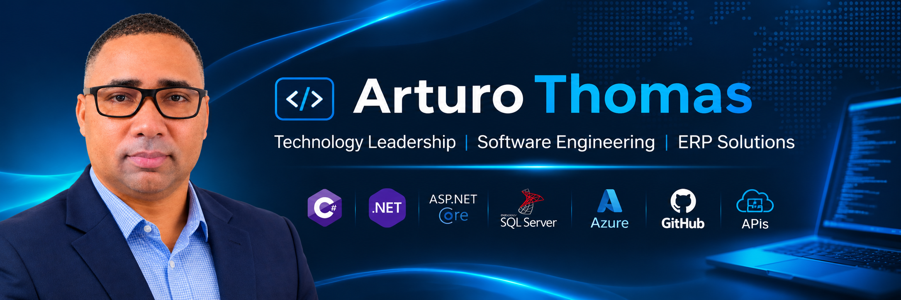

**IT professional · Enterprise software development · Technology modernization**

## About me

I'm an IT professional and software engineer with experience in the development and evolution of enterprise ERP solutions, systems integration, SQL Server databases, reporting, and technology infrastructure.

My work connects **software engineering, IT leadership, and real business needs**. I'm currently focused on modernizing enterprise applications and expanding my skills in modern .NET development, Azure, security, and APIs.

## Technology stack

- **Backend:** C#, .NET, ASP.NET Core MVC, REST APIs, Entity Framework Core
- **Data:** Microsoft SQL Server, T-SQL, database design
- **Cloud & infrastructure:** Azure, IIS, Windows Server
- **Enterprise solutions:** ERP, payroll, accounting, integrations, biometric attendance
- **Reporting:** Telerik Reporting, Crystal Reports

## Featured projects

| Project | Description | Status |
| --- | --- | --- |
| [Shop](https://github.com/arturoxthomas/Shop) | E-commerce application; modernization of its web, database, and administration features | In development |
| [Personal Portfolio](https://github.com/arturoxthomas/arturo-thomas) | Personal website and interactive Tech Runner game | Active |
| [ForeignExchange](https://github.com/arturoxthomas/ForeignExchange) | Legacy Xamarin mobile project for Android and iOS | Under review |

## GitHub activity

> This graph is provided by a third-party service and may be temporarily unavailable. GitHub's official contribution calendar is also visible on my profile.

## Currently exploring

- Modern .NET architecture and application modernization
- Cloud deployment and security on Microsoft Azure
- API design and enterprise integrations
- AI-assisted software development

---

**Building practical technology solutions for real business needs.**

[LinkedIn](https://www.linkedin.com/in/arturo-thomas-aa14a7a1/) · [Portfolio repository](https://github.com/arturoxthomas/arturo-thomas)

